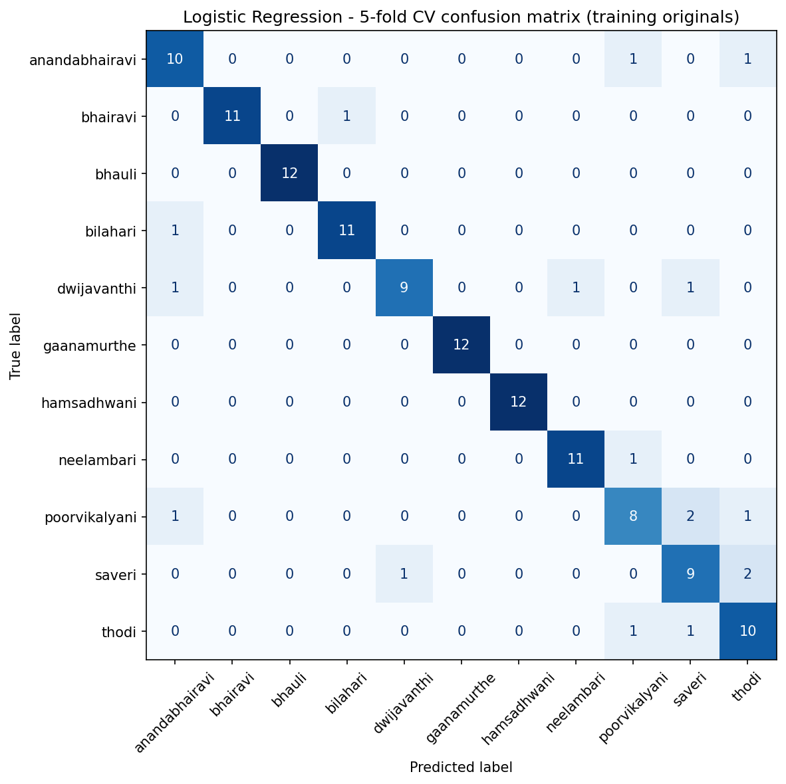

# Raga Multimodal Classifier

Multimodal recognition of Carnatic ragas from raw audio, combining classical machine learning with deep learning. This repository documents an end-to-end pipeline — from messy real-world audio to a cross-validated classifier with honest error analysis — built as a data science portfolio project.

> **Status:** Phase 1 (classical ML baseline) complete · Phase 2 (multimodal deep learning) in progress.

## Problem

A *raga* is the melodic framework of Indian classical music, defined by its set of swaras (notes) and its characteristic phrasing. Automatic raga recognition is a hard music-information-retrieval problem: different ragas can share note sets and differ mainly in ornamentation and melodic movement. This project builds a raga classifier and, in later phases, infers the emotional character associated with each raga.

## Dataset

**RaagaDhvani — Carnatic Raga Emotion Audio Dataset:** 11 Carnatic ragas performed as solo flute renditions, with per-raga emotion annotations and augmentation variants.

- 165 original recordings (15 per raga — perfectly balanced)
- 448 augmentation variants (pitch shift, time stretch, additive noise)
- Emotion mapped deterministically per raga (e.g., Bhairavi → devotion)

> Archana Priyadarshini. (2025). *Carnatic Raga Emotion Audio Dataset (RaagaDhvani)*. NMAMIT, Nitte (Deemed to be University). Licensed under CC BY-ND 4.0.

*Audio files are not redistributed in this repository, per the dataset license.*

## Methodology (Phase 1)

**Data cleaning.** Filenames encoded raga, emotion, and augmentation, but with real-world inconsistencies: spelling variants (Bowli/Bhauli, Nilambari/Neelambari, dhwijavanthi/Dwijavanthi) and inconsistent flute prefixes (`F_`, `F`, `F_flute_`). An alias-aware parser reached 100% parse coverage across all 613 files.

**Leakage-safe split.** Because augmented filenames do not preserve their source-recording identity, augmentations cannot be cleanly separated from originals at the recording level. The baseline therefore trains and evaluates on the 165 original recordings only, with a stratified 80/20 split. The 33-file test set was sealed and evaluated exactly once.

**Features.** Per-recording aggregated descriptors via `librosa`: 20 MFCCs (timbre), 12-bin chroma (pitch-class / tonal content), and spectral centroid, bandwidth, rolloff, zero-crossing rate, and RMS — mean and standard deviation over time. 69 features total.

**Models.** Logistic Regression, Random Forest, and HistGradientBoosting compared via stratified 5-fold cross-validation on the training set, against a chance baseline.

## Results (Phase 1)

| Model | CV Accuracy | CV Macro-F1 |
|---|---|---|
| Chance (dummy) | 0.076 | 0.013 |
| **Logistic Regression** | **0.871 ± 0.090** | **0.868 ± 0.099** |
| Random Forest | 0.803 ± 0.096 | 0.802 ± 0.085 |
| HistGradientBoosting | 0.780 ± 0.075 | 0.787 ± 0.081 |

**Held-out test (evaluated once): 0.909 accuracy, 0.91 macro-F1.**

A regularized linear model outperformed the tree ensembles — the expected outcome on a small, well-featurized dataset where higher-capacity models overfit. Choosing the simpler, better-generalizing model over a reflexive gradient-boosting default is a deliberate decision, not a default.



**Error analysis.** Errors concentrate among poorvikalyani, saveri, and thodi — ragas distinguished more by phrasing and ornamentation than by note set. Time-aggregated features capture *which* pitch classes occur but discard melodic motion. This is the ceiling of a bag-of-features representation and the motivation for the deep learning phase.

## Roadmap

- **Phase 2 — Multimodal deep learning:** mel-spectrogram CNN branch + audio-feature branch + metadata embeddings, fused via cross-attention, to capture phrase-level structure the baseline cannot.
- **Phase 3 — Mood inference:** map ragas to continuous valence/arousal coordinates (affective circumplex) and regress emotional character, conditioned on the raga prediction.
- **Phase 4 — Deployment:** live Gradio demo on HuggingFace Spaces + drift monitoring on GCP.

## Limitations

- Solo flute only — generalization to vocal or other instruments is untested.
- Raw chroma is tonic-dependent; tonic normalization is a planned improvement.
- Small dataset (165 originals); the deep learning phase will use leakage-safe augmentation performed only on training recordings.

## Evaluation checks (package rerun)

Each raga's 15 originals are consecutive ~20 s cuts of one studio performance (14 clips are exactly 20.0 s; the remainder clip is 22–30 s; Dwijavanthi and Thodi are cut differently). A random split therefore tests generalisation *within* a performance, not to new performances. Two checks on the training originals, cross-validation only (the sealed test set was not re-scored):

| Config | Features | CV | Accuracy | Macro-F1 |
|---|---|---|---|---|
| `baseline` | all 69 | stratified | 0.878 ± 0.086 | 0.870 ± 0.095 |
| `ablations/blocked` | all 69 | blocked | 0.856 ± 0.025 | 0.835 ± 0.054 |
| `ablations/chroma_only` | chroma (24) | stratified | 0.841 ± 0.102 | 0.826 ± 0.098 |
| `ablations/chroma_only_blocked` | chroma (24) | blocked | 0.818 ± 0.077 | 0.814 ± 0.068 |
| `ablations/mfcc_only` | MFCC (40) | stratified | 0.711 ± 0.082 | 0.700 ± 0.099 |
| `ablations/mfcc_only_blocked` | MFCC (40) | blocked | 0.679 ± 0.077 | 0.656 ± 0.095 |

- **Blocked CV** holds out contiguous ranges of clip indices so validation clips are not time-neighbours of training clips. Accuracy drops only ~2 points, so adjacency leakage is small.
- **Pitch-class content carries the signal**: chroma alone beats MFCC (timbre) alone by ~13 points, which argues against the model recognising recording conditions.
- **What this cannot rule out**: with one performance per raga, a model could still key on that performance's tonic or habits. Only recordings from other performances can test that.
- **CV noise**: the package sorts files, so its folds differ from the notebook's (0.878 vs 0.871; in the notebook's row order the package reproduces 0.871 ± 0.090 exactly). HistGradientBoosting ranges 0.68–0.78 across fold seeds alone, so model rankings closer than ~0.1 are not reliable from a single 5-fold run.
- **Held-out test**: 30/33 correct is a 95% interval of roughly 0.76–0.97.

## Repository structure

```
raga-multimodal-classifier/
├── src/raga/
│   ├── data.py        # filename parser, raga/emotion maps, dataset manifest
│   ├── split.py       # frozen splits + stratified / blocked CV folds
│   ├── features.py    # 69 aggregated MFCC / chroma / spectral features (cached)
│   ├── models.py      # config name -> scikit-learn estimator
│   ├── evaluate.py    # CV, bootstrap CIs, confusion matrices
│   ├── train.py       # end-to-end run -> artifacts/runs/<name>/
│   ├── predict.py     # RagaPredictor: audio file or array -> top-k ragas
│   └── cli.py         # `raga manifest | train | predict`
├── configs/           # one YAML per run; ablations/ holds the checks above
├── splits/legacy_stratified.json   # the Phase 1 train/test split, frozen
├── tests/             # synthetic-audio tests; no dataset needed
├── 01_data_inventory.ipynb, 02_features_baseline.ipynb   # original exploration
├── data/              # dataset (git-ignored)
└── artifacts/         # models, metrics, feature cache (git-ignored)
```

## How to run

```bash
conda create -n raga-project python=3.10 -y
conda activate raga-project
pip install -e ".[dev]"

# Download the RaagaDhvani dataset (CC BY-ND 4.0), then point at its root:
export RAGA_DATA_DIR="data/RaagaDhvani-A novel curated Augmented Carnatic mus/RaagaDhvani_Dataset_VidushiArchana"

make test        # unit + end-to-end tests on synthetic audio
make manifest    # parse all 613 filenames -> artifacts/manifest.csv
make train       # baseline: CV, fit, save artifacts/runs/baseline/model.joblib
make ablations   # comparison models + the evaluation checks above

raga predict path/to/clip.wav --model artifacts/runs/baseline/model.joblib
```

`make train` never touches the sealed test set. Scoring it requires
`raga train --config configs/baseline.yaml --evaluate-test`, and every such run is
appended to `artifacts/test_evaluations.jsonl` so repeated looks are on record.
